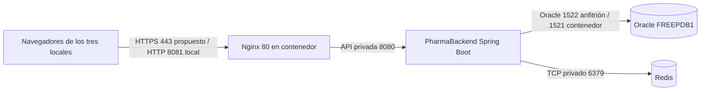

# PharmaSoft frontend

SPA Angular 22 de PharmaSoft con autenticación, permisos, Categorías, Clientes, Productos, Ventas y Reportes. Código organizado en `core`, `shared`, `layout` y `features`. La sección de producción al final corresponde a la actividad autónoma S13; las notas fechadas de la sesión 7 se conservan como antecedentes.

## Ejecutar

Desde esta carpeta, con Node 24 LTS y npm disponibles:

```powershell
npm install
npm start
```

Abrir **http://localhost:4200**. Iniciar PharmaBackend y Oracle por separado. En desarrollo, la API usa `environment.development.ts`: `http://localhost:8080/api/v1`. En producción, `environment.ts` usa `/api/v1` a través de Nginx.

Si npm no está en PATH pero las dependencias ya están instaladas:

```powershell
node node_modules/@angular/cli/bin/ng.js serve
```

## Verificar

```powershell
npm run build
npm test -- --watch=false
```

Comandos equivalentes sin npm:

```powershell
node node_modules/@angular/cli/bin/ng.js build
node node_modules/@angular/cli/bin/ng.js test --watch=false
```

Resultado de la revisión del 24/09/2026: compilación correcta; 41 pruebas automatizadas aprobadas. HTTP se simula en las pruebas unitarias; no prueban Oracle ni CORS. Se comprobó en Edge la navegación, menú, 404, validación sin POST y error de conexión. Las capturas están en `output/evidencias`.

## Organización

- `core/config/menu.ts`: menú único para Inicio, Categorías y Clientes.
- `core/models` y `core/utils`: contrato de errores y traducción de respuestas HTTP.
- `layout`: Header emite el evento del menú; MainLayout mantiene su estado y aloja RouterOutlet; Sidebar recorre MENU.
- `shared/pages/no-encontrado`: página 404.
- `features/categorias` y `features/clientes`: modelos, servicio HTTP, listado, formulario y rutas propias.
- `app.config.ts`: registra HttpClient, Router y enlace de parámetros a inputs.
- `app.routes.ts`: MainLayout como padre, inicio y features diferidas, redirección inicial y comodín 404.

Los listados usan signals para datos/carga/error y computed para filtrar sin nuevas peticiones. Los formularios reactivos comparten registro y edición, reciben `id` desde la ruta, validan valores recortados, muestran errores del servidor y evitan envíos duplicados. Un error al precargar impide guardar un formulario incompleto.

## Contrato real del backend local

La guía original ilustra `Categoria.id` y nombres de 3 a 50 caracteres. **El backend local devuelve `id_categoria` y admite de 3 a 30**. El frontend sigue sus DTO. En la sesión 13 se amplió el contrato de errores con requestId en ambos repositorios.

Clientes: DNI de 8 dígitos; nombres/apellidos de 2 a 100; correo obligatorio válido hasta 150; teléfono opcional de 9 dígitos; dirección opcional hasta 250. Los opcionales vacíos se envían como null. Categorías: descripción opcional hasta 200. Ambos tienen estado booleano.

Cada servicio concentra GET colección, GET por ID, POST, PUT por ID y DELETE por ID. Se muestran los mensajes del backend, incluidos 400, 404 y 409, y un mensaje comprensible para status 0.

## Pendientes históricos de la sesión 7

1. Mantener PharmaBackend con Oracle iniciado en el puerto 8080. La conexión de Categorías y Clientes devolvió HTTP 200 y CORS autorizó http://localhost:4200 tras corregir la URL del frontend.
2. Realizar las doce pruebas del paso 11; completar capturas con F12 > Red en las que corresponda. Consultar `output/PLAN_DE_EVIDENCIAS.md`.
3. Completar apellido y datos del estudiante en el informe. El PDF actual contiene evidencias parciales y no sustituye las doce capturas exigidas.
4. Crear la rama solicitada por el docente, registrar al menos cuatro commits y publicar en tu repositorio. No hay remoto Git configurado; no se han creado commits ni publicado cambios.

No es necesario repetir `git init`: el proyecto ya tiene repositorio. Conviene separar commits de configuración/layout, Categorías, Clientes y pruebas/documentación. Agregar explícitamente archivos nuevos antes de cada commit.

## Sesión 11: seguridad frontend (22/10/2026)

Implementada en `feature/seguridad-frontend-asmat`, conservando la rama existente y el backend.

- Login reactivo con validación y mensaje genérico ante credenciales inválidas o cuenta inactiva.
- Sesión en signal y `sessionStorage` (`pharmasoft.sesion`), recuperación al recargar, descarte de datos dañados, temporizador de expiración.
- Bearer solo para la API configurada, excluyendo el login. Un 401 de la API cierra la sesión; 403 conserva la sesión y llega al componente.
- Guards de sesión y permiso para lectura y escritura; retorno a rutas internas tras el login.
- Menú y acciones por permisos, incluidos Clientes y Reportes. Encabezado con nombre, roles, vencimiento y cierre de sesión.
- `/mi-cuenta`: nombre, usuario, roles, permisos y expiración; nunca muestra el token.

Verificación: compilación de producción correcta y 84 pruebas aprobadas (29 archivos). HTTP y el reloj se simulan en las pruebas de seguridad. También se comprobó la API local con los cinco usuarios de la guía y se probaron los flujos de navegación en el navegador.

Informe: `output/pdf/Asmat_LP2_S11_Practica.pdf`. Capturas: `output/evidencias-s11`. El informe tiene 12 capturas de los casos de la guía y una de Mi cuenta. Faltan las evidencias manuales de los casos 6, 7, 15 y 16; el PDF explica cómo obtenerlas. Completar los datos del estudiante antes de entregar. Los apartados anteriores corresponden a sesiones previas.

Si el entorno de Windows causa ENOENT en el directorio temporal del ejecutor de pruebas:

```powershell
New-Item -ItemType Directory -Force .tmp | Out-Null
$env:TEMP=(Resolve-Path .tmp).Path
$env:TMP=$env:TEMP
node node_modules/@angular/cli/bin/ng.js test --watch=false
```

## Actividad autónoma de la sesión 11

Rama: `feature/seguridad-spa-pruebas-asmat`.

- `AuthService` conserva la sesión de la práctica y añade `segundosRestantes`, `porVencer`, `obtenerPerfil()` y ocultación del aviso por sesión. El intervalo actualiza la cuenta cada segundo; cerrar sesión o destruir el servicio cancela el intervalo y el temporizador de expiración.
- `shared/components/aviso-sesion` aparece durante los últimos 120 segundos, muestra mm:ss y permite ocultar el aviso o cerrar sesión. Está encima del RouterOutlet en MainLayout; la sesión nunca se renueva desde el navegador.
- `/mi-cuenta` usa la protección del layout para cualquier usuario autenticado, sin permiso adicional. Consulta GET `/api/v1/auth/me`, presenta carga, error y reintento, roles como etiquetas y permisos agrupados por módulo. Si el conjunto de permisos del servidor difiere del de la sesión, pide volver a ingresar sin sobrescribir la sesión actual.
- El backend local usa `empleadoNombre` en `/auth/me`; `obtenerPerfil()` lo convierte al `nombreCompleto` utilizado en la pantalla. También acepta el nombre del contrato de la guía.
- El login ignora un segundo envío mientras está procesando el primero, además de deshabilitar el botón.

La matriz editable está en `docs/matriz-seguridad-spa-s11.md`: 16 casos base, cuatro propios de grupos distintos y B-01 a B-04. Los resultados manuales y sus capturas deben registrarse al ejecutarlos; las pruebas automatizadas no sustituyen la evidencia de navegador.

Para comprobar el aviso manualmente, configurar temporalmente `app.jwt.expiracion-minutos: 3` en PharmaBackend, reiniciarlo e iniciar una sesión nueva. El aviso aparece cuando quedan dos minutos, aproximadamente un minuto después del login. Probar ocultación, navegación y cierre; al terminar restaurar 60 minutos y reiniciar. No se ha cambiado esa configuración desde esta actividad.

La entrega aún requiere el informe C1-C3 en `docs/informe-s11.pdf`, las capturas sin tokens completos y tres commits en días distintos con fechas reales, además del PR hacia develop. Los archivos de evidencia de la práctica anterior son históricos y deben revisarse antes de publicarlos.


---

## Despliegue en producción

### Arquitectura y puertos



El entorno medido usa Nginx en `localhost:8081`, backend en `localhost:8080`, Oracle en `localhost:1522` y Redis en `localhost:6379`. El Compose de desarrollo publica Redis para redis-cli; en producción se debe restringir a red privada. Los navegadores solo acceden a Nginx. HTTPS todavía no está configurado en este laboratorio.

### Variables de entorno

No guardar valores reales en Git ni en capturas. Spring no carga automáticamente un archivo `.env` arbitrario al ejecutar el JAR.

| Variable | Propósito |
|---|---|
| `SPRING_PROFILES_ACTIVE` | Seleccionar `prod` |
| `SERVER_PORT` | Puerto HTTP privado del backend |
| `DB_URL` | URL JDBC del servicio Oracle |
| `DB_USERNAME`, `DB_PASSWORD` | Credenciales del usuario Oracle de la aplicación |
| `JWT_SECRET` | Clave Base64 aleatoria de al menos 32 bytes para HS256; mantener estable entre reinicios |
| `JWT_EXPIRACION_MINUTOS` | Vigencia del token; valor predeterminado 30 minutos |
| `FRONTEND_ORIGINS` | Orígenes autorizados si se accede directamente al backend con CORS |
| `REDIS_HOST`, `REDIS_PORT` | Instancia Redis privada compartida por los procesos del mismo despliegue |
| `SPRING_CACHE_REDIS_TIME_TO_LIVE` | Vigencia de seguridad de las entradas; configuración normal `10m` |

Un `.env` puede ser usado por Docker Compose para interpolación; eso no implica que el proceso Java iniciado por separado lo reciba. Usar un gestor de secretos o variables del servicio. No introducir una clave JWT nueva en cada arranque: invalidaría sesiones. En el laboratorio de pruebas se usó una clave temporal distinta de las credenciales del proyecto.

### Construir y desplegar

1. Instalar dependencias con `npm ci`. La API de producción se compila como `/api/v1`; no incluir claves JWT ni contraseñas en `environment.ts`. Las variables del backend pertenecen al servicio Java, no al navegador.
2. Verificar con `npm test -- --watch=false` y `npm run build -- --stats-json`. Guardar el contenido completo de `dist/pharma-frontend/browser` como una release. `npm run build -- --configuration production,preload` habilita la alternativa experimental; la configuración normal conserva NoPreloading.
3. Respaldar la release anterior fuera de `dist`. En este laboratorio, desde la raíz ejecutar `docker compose -f deploy/docker-compose.yml up -d`. Nginx monta el directorio compilado; el backend Java y Oracle se inician por separado. El nombre `backend` del proxy apunta al anfitrión mediante host-gateway.
4. Validar la configuración con `docker compose -f deploy/docker-compose.yml exec -T web nginx -t`; si cambió nginx.conf, aplicar `docker compose -f deploy/docker-compose.yml exec -T web nginx -s reload`.
5. Abrir http://localhost:8081, comprobar login, F5 en Productos, acceso a Ventas y un error con código de seguimiento. Comprobar con `curl.exe -I` el index y los archivos con hash. La respuesta sin token de una ruta protegida debe seguir siendo 401.
6. En una instalación real publicar una carpeta de release completa de forma atómica; conservar los archivos con hash de la release anterior durante las sesiones abiertas. Compilar directamente sobre la carpeta publicada se hizo solo para la simulación pedida por la guía y tiene una ventana de archivos incompletos.

### Volver a la versión anterior

Restaurar la carpeta completa de la release anterior, incluyendo su index.html y todos sus hashes; validar Nginx y recargar. Probar F5 y una consulta. No hace falta que el usuario borre su caché: index.html se revalida y referencia los archivos de esa release. Si cambia el contrato del API, coordinar el rollback con PharmaBackend y sus migraciones Oracle; restaurar la SPA no revierte la base de datos.

### Estado de buenas prácticas

| Práctica de la sesión | Estado observado | Acción pendiente |
|---|---|---|
| Features lazy y reporte inicial diferido | Cumple | Vigilar los presupuestos del build |
| Optimización adicional medida | Cumple | Layout lazy reduce Initial total de 318,32 a 311,41 kB en comparación aislada |
| Caché de archivos con hash e index revalidable | Cumple | Desplegar archivos de forma atómica y conservar los anteriores |
| API sin almacenamiento en navegador | Cumple | Mantener los encabezados de Spring Security |
| Redis con TTL e invalidación | Cumple | Repetir matriz al cambiar servicios; TTL normal diez minutos |
| Fallback cuando Redis falla | Cumple | Alerta operativa de degradación; no confundir disponibilidad con salud UP |
| Perfil prod, SQL y bind desactivados | Cumple | Mantener separados los secretos de desarrollo |
| RequestId en log, errores y SPA | Cumple | Incorporar búsqueda centralizada para soporte |
| Logs sin secretos y con rotación | Cumple parcialmente | Auditoría local aprobada; faltan retención central y control de acceso operativo |
| Health y métricas protegidas | Cumple parcialmente | ADMIN controla detalles/métricas; faltan alertas e infraestructura privada definitiva |
| HTTPS | No cumple | Configurar certificado y redirección en el proxy |
| Respaldo y recuperación Oracle | Cumple parcialmente | No se verificó un procedimiento automático ni una restauración de producción |
| Pruebas automatizadas | Cumple | 55 backend y 111 frontend; mantener en CI |

### Tres recomendaciones priorizadas para los tres locales

1. **Antes de abrir acceso remoto:** publicar solo Nginx con HTTPS, certificado renovable y reglas de red. Oracle, Redis y Actuator deben quedar en red privada. No exponer el puerto 6379 usado en el laboratorio.
2. **Antes de operar ventas reales:** automatizar copias de Oracle, probar una restauración y conservar releases para rollback. Definir con la botica el tiempo máximo de interrupción y pérdida aceptable, sin suponer que Redis reemplaza un respaldo.
3. **Para operar los tres locales:** utilizar una API y una base coherentes, Redis compartido por los procesos de esa API y monitoreo central de salud, latencia, errores y caché. Las instancias de Redis independientes por local dejarían copias incoherentes; agregar alertas y responsables de respuesta.

### Evidencias y alcance

Las mediciones del 08/11/2026 corresponden a una sola máquina local y datos de prueba. No permiten estimar capacidad para tres locales ni percentiles bajo carga. El ensayo conservó ventas 122 y 123, producto 73, cliente ficticio 101 y categoría 167 para trazabilidad; eliminó únicamente su categoría vacía 168. El TTL de un minuto y la caída de Redis fueron temporales.

Fuentes: [Angular PreloadAllModules](https://angular.dev/api/router/PreloadAllModules), [esbuild analyzer](https://esbuild.github.io/analyze/), [Spring Security headers](https://docs.spring.io/spring-security/reference/features/exploits/headers.html), [Spring Boot metrics](https://docs.spring.io/spring-boot/reference/actuator/metrics.html).
